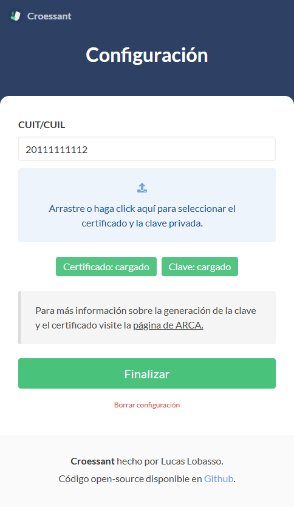
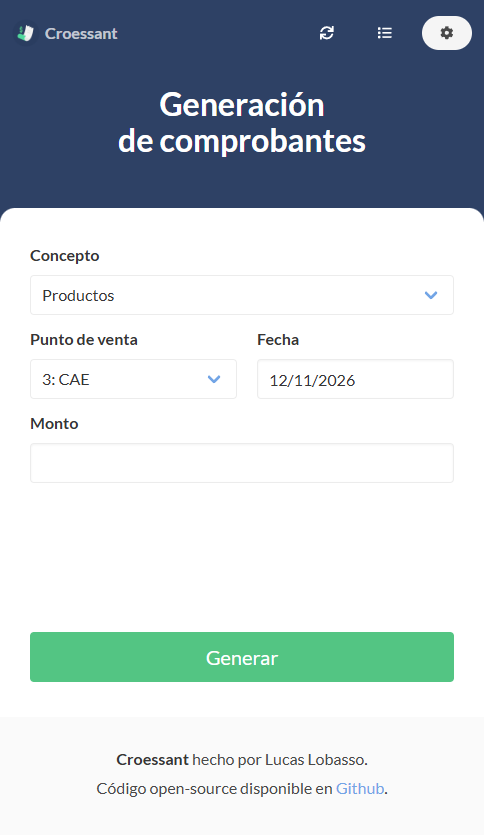
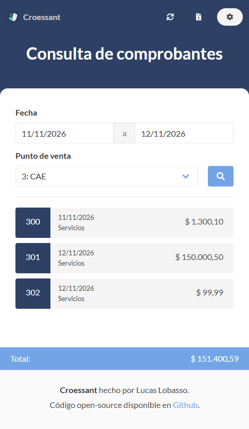

<br/>
<!-- Logo & Title-->
<div align="center">
  

  # Croessant
</div>


<!-- Description -->
<p align="center">
  ¡La forma más rápida y fácil de generar tus facturas!
  <br/>
  <a href="https://github.com/lucaslobasso/afip-invoicer/releases"><strong>Haga click aquí para descargar</strong></a>
  <br/>
  <br/>
  <a href="https://github.com/lucaslobasso/afip-invoicer/issues">Reportar un bug</a>
  ·
  <a href="https://github.com/lucaslobasso/afip-invoicer/issues">Pedir un feature</a>
</p>

<!-- Shields -->
<div align="center">

  
  
  
  
  
</div>
<div align="center">

  
  
  
</div>

<!-- Table of contents -->
<details open="open">
  <summary>Tabla de contenidos</summary>
  <ol>
    <li><a href="#acerca-del-proyecto">Acerca del proyecto</a></li>
    <li><a href="#guía-de-inicio">Guía de inicio</a></li>
    <li><a href="#como-usarlo">Como usarlo</a></li>
    <li><a href="#dónde-se-guardan-mis-datos">Dónde se guardan mis datos</a></li>
    <li><a href="#desarrollo">Desarrollo</a></li>
    <li><a href="#roadmap">Roadmap</a></li>
    <li><a href="#contribuciones">Contribuciones</a></li>
    <li><a href="#licencia">Licencia</a></li>
    <li><a href="#contacto">Contacto</a></li>
  </ol>
</details>

<!-- About -->
## Acerca del proyecto

<strong>Croessant</strong> es una simple aplicación de escritorio para generar y ver tus Facturas C de la Agencia de Recaudación y Control Aduanero (ARCA, ex AFIP) de la manera más rápida y sencilla posible.

Fue creada con la intención de simplificar al máximo el proceso de generación de facturas para los monotributistas de la Argentina.

Se conecta directamente con los web services oficiales de ARCA (WSAA y WSFEv1): tu certificado y tu clave privada nunca salen de tu computadora ni pasan por servicios de terceros.

Además, corre en Linux, macOS y Windows.

<!-- Getting started -->
## Guía de inicio

Deberás generar un `Certificado Digital para Web Services` (para producción) desde la página de ARCA y asociarlo al servicio de <strong>Facturación Electrónica (wsfe)</strong>. Esto te dará un <strong>certificado</strong> y una <strong>clave privada</strong> necesarios para el funcionamiento de la aplicación.

También necesitás un <strong>punto de venta</strong> habilitado para factura electrónica por Web Services.

Ir a https://www.arca.gob.ar/ws/documentacion/certificados.asp para obtener más información de cómo generar la clave y el certificado.

> Los certificados de ARCA vencen (normalmente a los dos años). Si la aplicación te avisa que el certificado está vencido, generá uno nuevo y volvé a cargarlo desde la pantalla de `Configuración`.

<!-- Usage -->
## Como usarlo

Primero debes cargar tu CUIT/CUIL, el certificado y la clave generados en la `Guía de inicio` en la pantalla de `Configuración` que aparecerá apenas abras la aplicación. Podés arrastrar los archivos o seleccionarlos; no importa cómo se llamen.

<div align="center">
  
</div>
<br/>

Luego podrás generar tu primer factura tipo C desde la pantalla de `Generación de comprobantes`. Solo tenés que elegir el <strong>concepto</strong>, el <strong>punto de venta</strong> (de tener varios), la <strong>fecha</strong> y finalmente el <strong>monto</strong>.

<strong>Croessant</strong> se encarga automáticamente de darte a elegir dentro de un rango válido de fechas y de validar los montos mínimos y máximos permitidos.

Las facturas se emiten a <strong>consumidor final sin identificar</strong>, por lo que el monto debe ser menor a $10.000.000 (a partir de ese importe ARCA exige identificar al comprador, RG 5700/2025).

También, podés ver tus comprobantes dentro de un rango de fechas desde la pantalla de <strong>Consulta de comprobantes</strong>.

<div align="center">
  
  
</div>

<!-- Data -->
## Dónde se guardan mis datos

El CUIT/CUIL (`cuit.txt`), el certificado (`cert.crt`), la clave privada (`key.key`) y el ticket de acceso de ARCA (`ta-*.json`) se guardan en la carpeta de datos de la aplicación:

| Sistema | Carpeta |
| --- | --- |
| Windows | `%APPDATA%\Croessant` |
| macOS | `~/Library/Application Support/Croessant` |
| Linux | `~/.config/Croessant` |

Para borrarlos usá el botón `Borrar configuración` de la pantalla de `Configuración`.

<!-- Development -->
## Desarrollo

Requiere [Node.js](https://nodejs.org) 22.13 o superior (con npm 10.9 o superior).

```sh
npm install
npm start       # compila los estilos y abre la aplicación
npm test        # tests unitarios (no se conectan con ARCA)
npm run make    # genera los instaladores en out/
```

Para probar contra el ambiente de homologación (pruebas) de ARCA, con un certificado de homologación:

```sh
CROESSANT_ENV=homologation npm start
```

El código está organizado en:

- `src/arca`: cliente de los web services de ARCA (WSAA y WSFEv1) y reglas de facturación.
- `src/main`: configuración, IPC y preload del proceso principal de Electron.
- `src/views`, `src/js`, `src/scss`: las pantallas.

<!-- Roadmap -->
## Roadmap

Mirá los [open issues](https://github.com/lucaslobasso/afip-invoicer/issues) para el listado de los features propuestos (e issues conocidos).


<!-- Contributing -->
## Contribuciones

Las contribuciones son lo que hace que la comunidad de código abierto sea un lugar increíble para aprender, inspirar y crear. Cualquier contribución que hagas es **muy apreciada**.

1. Forkea el proyecto.
2. Crea tu branch (`git checkout -b feature/AmazingFeature`).
3. Commitea tus cambios (`git commit -m 'Add some AmazingFeature'`).
4. Pushea los commits a tu branch (`git push origin feature/AmazingFeature`).
5. Generá un `Pull Request`.


<!-- License -->
## Licencia

Distribuido bajo la MIT License. Leer `LICENSE.md` para más información.


<!-- Contact -->
## Contacto

Lucas Damián Lobasso - lobassolucas@gmail.com

Link del proyecto: [https://github.com/lucaslobasso/afip-invoicer](https://github.com/lucaslobasso/afip-invoicer)
